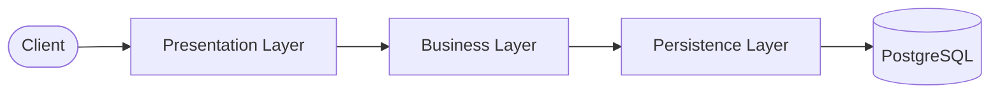

# Hệ thống Đặt hàng Flash Sale - Pha 1

## 1. Mô tả bài toán và nghiệp vụ cơ bản

Hệ thống phục vụ các chiến dịch bán hàng Flash Sale. Điểm khó khăn chính của bài toán là xử lý lượng truy cập đồng thời lớn khi nhiều khách hàng cùng tranh mua một số lượng hàng hóa có hạn, đòi hỏi tính nhất quán của dữ liệu tồn kho và thời gian phản hồi nhanh.

| Role     | Nghiệp vụ                                                                                                             |
| :------- | :-------------------------------------------------------------------------------------------------------------------- |
| Customer | Xem danh sách và chi tiết các sản phẩm Flash Sale, đặt mua sản phẩm, xem lịch sử đơn hàng của bản thân, hủy đơn hàng. |
| Admin    | Thêm/xóa sản phẩm trong danh sách Flash Sale                                                                          |

Nghiệp vụ cơ bản:

- Khách hàng có thể duyệt danh sách các mặt hàng đang mở bán và số lượng tồn kho của từng mặt hàng.
- Khách hàng chọn sản phẩm và số lượng muốn mua. Hệ thống kiểm tra số lượng tồn kho trong CSDL:
  - Nếu vẫn còn đủ số hàng: Trừ số lượng tương ứng và tạo bản ghi đơn hàng mới.
  - Nếu hết hàng: Từ chối yêu cầu và trả về lỗi.
- Khách hàng có thể hủy đơn hàng của mình. Khi đơn hàng bị hủy, số lượng tương ứng sẽ được hoàn lại vào kho hàng.

## 2. Kiến trúc hệ thống

### 2.1. Kiến trúc phân tầng

Hệ thống được tổ chức thành ba lớp: Presentation Layer, Business Layer và Persistence Layer:



- Presentation Layer: Tiếp nhận request từ client, kiểm tra xác thực/phân quyền và trả về kết quả.

- Business Layer: Xử lý logic nghiệp vụ như kiểm tra tồn kho, tính tổng tiền và hoàn kho khi hủy đơn.

- Persistence Layer: Chịu trách nhiệm quản lý và tương tác với cơ sở dữ liệu PostgreSQL.

### 2.2. Tổ chức mã nguồn

Framework: FastAPI

| Thư viện          | Vai trò                                       |
| :---------------- | :-------------------------------------------- |
| Uvicorn           | Chạy ứng dụng FastAPI.                        |
| Pydantic          | Định nghĩa schema.                            |
| SQLAlchemy        | Ánh xạ bảng, truy vấn và quản lý transaction. |
| Psycopg           | Kết nối PostgreSQL.                           |
| Python JOSE       | Tạo và xác minh JWT.                          |
| Passlib và bcrypt | Băm và kiểm tra mật khẩu.                     |

```text
app/
├── api/                        Presentation Layer
│   ├── v1/
│   │   ├── router.py           Tổng hợp các router
│   │   ├── auth.py             Đăng nhập, đăng xuất và thông tin cá nhân
│   │   ├── products.py         API sản phẩm
│   │   └── orders.py           API đơn hàng
│   ├── schemas.py              Schema request/response
│   └── dependencies.py         Cung cấp dependency, xác thực và phân quyền
├── services/                   Business Layer: xử lý nghiệp vụ
│   ├── auth_service.py         Xác thực người dùng
│   ├── product_service.py      Quản lý sản phẩm
│   └── order_service.py        Đặt và hủy đơn hàng
├── domain/                     Business Layer: các định nghĩa nghiệp vụ
│   ├── models.py               Entity người dùng, sản phẩm và đơn hàng
│   ├── repositories.py         Interface repository
│   └── exceptions.py           Lỗi nghiệp vụ
├── infrastructure/             Persistence Layer
│   ├── models.py               ORM model
│   └── repositories.py         Repository SQLAlchemy
├── core/                       Các thành phần hỗ trợ
│   ├── config.py               Cấu hình ứng dụng
│   ├── database.py             Kết nối và session CSDL
│   └── security.py             Mật khẩu và JWT
└── main.py                     Khởi tạo ứng dụng và đăng ký router
```

## 3. Đặc tả các REST API

- Đặc tả OpenAPI: [openapi.json](openapi.json).
- Xem và thử API bằng Swagger UI: [http://localhost:8000/docs](http://localhost:8000/docs) sau khi khởi động hệ thống.
- Base URL: `/api/v1`
- Xác thực: Gửi kèm header `Authorization: Bearer <access_token>` đối với các route yêu cầu xác thực.

### Bảng tổng hợp các endpoint

| Nhóm           | Method   | Đường dẫn             | Quyền hạn    | Mô tả chức năng                                               |
| :------------- | :------- | :-------------------- | :----------- | :------------------------------------------------------------ |
| **Auth**       | `POST`   | `/auth/login`         | Public       | Đăng nhập                                                     |
|                | `POST`   | `/auth/logout`        | Auth         | Đăng xuất                                                     |
|                | `GET`    | `/users/me`           | Auth         | Xem thông tin chi tiết của tài khoản                          |
| **Flash Sale** | `GET`    | `/products`           | Public       | Xem danh sách các sản phẩm đang mở bán Flash Sale             |
|                | `GET`    | `/products/{id}`      | Public       | Xem thông tin chi tiết và số lượng tồn kho của 1 sản phẩm     |
|                | `POST`   | `/products`           | **Admin**    | Thêm mới một sản phẩm vào danh sách Flash Sale                |
|                | `DELETE` | `/products/{id}`      | **Admin**    | Xóa một sản phẩm khỏi danh sách Flash Sale                    |
| **Orders**     | `POST`   | `/orders`             | **Customer** | Đặt mua sản phẩm Flash Sale                                   |
|                | `GET`    | `/orders`             | Customer     | Xem danh sách đơn hàng của người dùng hiện tại                |
|                | `GET`    | `/orders/{id}`        | Customer     | Xem chi tiết thông tin một đơn hàng                           |
|                | `POST`   | `/orders/{id}/cancel` | Customer     | Hủy đơn hàng                                                  |
| **Hệ thống**   | `GET`    | `/health`             | Public       | Kiểm tra trạng thái hoạt động của Backend và kết nối Database |

## 4. Hướng dẫn chạy dự án

### Cách 1: Sử dụng Docker Compose

Yêu cầu: Đã cài đặt Docker và Docker Compose.

1. Khởi động toàn bộ hệ thống:

```bash
docker compose up --build
```

2. Truy cập tài liệu API:

- Đường dẫn: `http://localhost:8000/docs`
- Tài khoản thử nghiệm:
  - Quản trị viên: `admin` / `admin123`
  - Khách hàng: `customer1` / `password123`

### Cách 2: Chạy trực tiếp bằng Python

Yêu cầu: Python 3.10+ và PostgreSQL đang chạy.

1. Cài đặt thư viện:

```bash
pip install -r requirements.txt
```

2. Thiết lập cấu hình:

- Sao chép `.env.example` thành `.env` và cập nhật thông tin `DATABASE_URL`.

3. Khởi tạo dữ liệu thử nghiệm:

```bash
python -m scripts.seed
```

4. Khởi chạy server:

```bash
uvicorn app.main:app --reload
```

## 5. Kết quả kiểm thử thực tế trên Kaggle

### 5.1. Tổng quan môi trường kiểm thử

- Cấu hình: Kaggle CPU, Accelerator: None, Internet on.
- Kiểm thử trên endpoint `POST /api/v1/orders`, timeout mỗi request 60 giây.
- Mỗi mức tải được chạy 3 lần độc lập; bảng kết quả ghi khoảng giá trị nhỏ nhất, lớn nhất của 3 lần.
- Chỉ số đánh giá:
  - HTTP 201: số request tạo đơn thành công; HTTP 500: số request server trả lỗi nội bộ.
  - Timeout: số request không nhận được phản hồi sau 60 giây.
  - Tồn kho thực tế: số lượng tồn kho còn lại của sản phẩm sau khi chạy; Đơn trong DB: số đơn hàng thực tế được ghi nhận trogn DB.
  - p95: thời gian phản hồi mà 95% request nhanh hơn hoặc bằng, tính cả request timeout.

### 5.2. Kịch bản thứ 1

Kịch bản kiểm thử:

- Khởi tạo một sản phẩm có số lượng tồn kho là 100.
- Gửi đồng thời 20 request đặt mua sản phẩm.
- Kiểm tra số đơn hàng được tạo và số lượng tồn kho còn lại.

| Request đồng thời | Đơn trong DB | Tồn kho mong đợi | Tồn kho thực tế |
| ----------------: | -----------: | ---------------: | --------------: |
|                20 |           20 |               80 |         95 – 96 |

Hệ thống chưa đảm bảo tính nhất quán của dữ liệu tồn kho khi xử lý các request đặt hàng đồng thời.

### 5.3. Kịch bản thứ 2

Kịch bản kiểm thử:

- Khởi tạo một sản phẩm có số lượng tồn kho là 10000 cho mỗi mức tải.
- Gửi tổng cộng 1000 request đặt mua sản phẩm, lần lượt với 10, 50, 100 và 200 client.
- Kiểm tra kết quả xử lý, thời gian phản hồi và số lượng tồn kho còn lại. Nếu tạo đủ 1000 đơn thì số lượng hàng tồn kho phải còn 9000.

| Client đồng thời | HTTP 201 | HTTP 500 |   Timeout | Đơn trong DB | Tồn kho mong đợi | Tồn kho thực tế |      p95 (ms) |
| ---------------: | -------: | -------: | --------: | -----------: | ---------------: | --------------: | ------------: |
|               10 |     1000 |        0 |         0 |         1000 |             9000 |     9538 – 9559 |     128 – 162 |
|               50 |     1000 |        0 |         0 |         1000 |             9000 |     9776 – 9793 |     751 – 871 |
|              100 |  10 – 18 | 86 – 102 | 865 – 881 |    271 – 287 |      9713 – 9729 |     9903 – 9913 | 60121 – 60139 |
|              200 |        0 |       40 | 950 – 955 |          --- |              --- |             --- | 60225 – 60347 |

Tồn kho mong đợi = 10000 − số đơn hàng thực tế được lưu.

Nhận xét:

- Ở mức 10 và 50 client, tất cả request đều thành công nhưng tồn kho vẫn bị trừ thiếu ở cả 3 lần chạy.
- Ở mức 100 client, phần lớn request bị lỗi hoặc timeout, p95 vượt 60 giây.
- Ở mức 200 client, không request nào thành công.

Khi số lượng request đặt hàng đồng thời tăng cao, hệ thống phản hồi chậm, khả năng xử lý chưa ổn định và dữ liệu tồn kho không còn chính xác.
