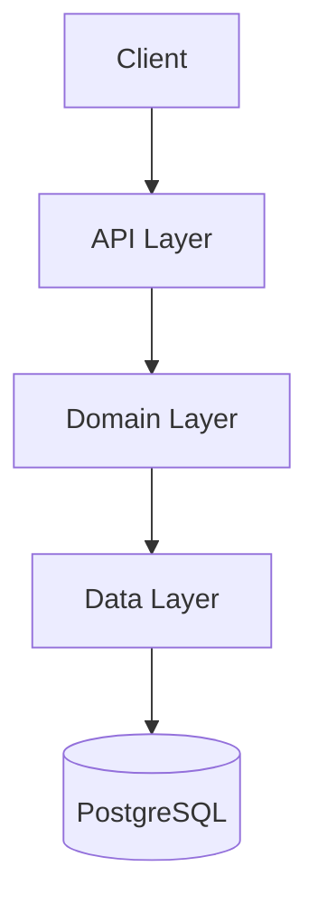
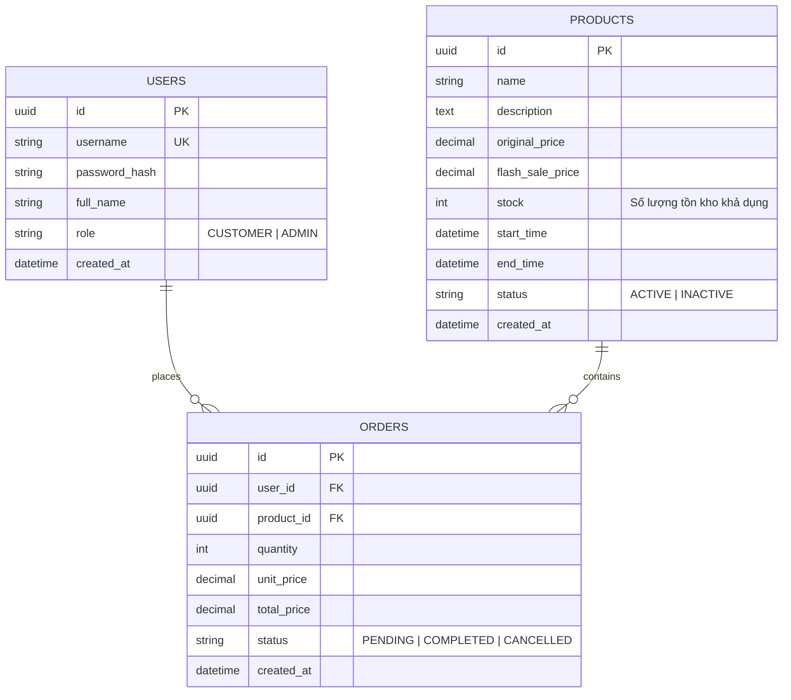

# Hệ thống Đặt hàng Flash Sale - Pha 1

## 1. Mô tả bài toán và nghiệp vụ cơ bản

Hệ thống phục vụ các chiến dịch bán hàng Flash Sale. Điểm khó khăn chính của bài toán là xử lý lượng truy cập đồng thời lớn khi nhiều khách hàng cùng tranh mua một số lượng hàng hóa có hạn, đòi hỏi tính nhất quán của dữ liệu tồn kho và thời gian phản hồi nhanh.

| Role | Nghiệp vụ |
| :--- | :--- |
| Customer | Xem danh sách và chi tiết các sản phẩm Flash Sale, đặt mua sản phẩm, xem lịch sử đơn hàng của bản thân, hủy đơn hàng. |
| Admin | Thêm/xóa sản phẩm trong danh sách Flash Sale |

Nghiệp vụ cơ bản:
- Khách hàng (kể cả chưa đăng nhập) có thể duyệt danh sách các mặt hàng đang mở bán và số lượng tồn kho khả dụng còn lại.
- Khách hàng đã đăng nhập chọn sản phẩm và số lượng muốn mua. Hệ thống kiểm tra số lượng tồn kho trong CSDL:
  - Nếu vẫn còn đủ số hàng: Trừ số lượng tương ứng và tạo bản ghi đơn hàng mới.
  - Nếu hết hàng: Từ chối yêu cầu và trả về lỗi.
- Khách hàng có thể hủy đơn hàng của mình. Khi đơn hàng bị hủy, số lượng tương ứng sẽ được hoàn lại vào kho hàng.

## 2. Kiến trúc hệ thống

### 2.1. Kiến trúc phân tầng



- Tầng API: Tiếp nhận HTTP Request, xử lý xác thực/phân quyền qua JWT Middleware, validate dữ liệu đầu vào và trả về kết quả JSON.
- Tầng Domain : Chứa logic nghiệp vụ (kiểm tra tồn kho, tính tổng tiền, logic hoàn kho khi hủy đơn). 
- Tầng Data : Chịu trách nhiệm tương tác trực tiếp với cơ sở dữ liệu PostgreSQL.

### 2.2. Mô hình dữ liệu

Hệ thống sử dụng cơ sở dữ liệu quan hệ PostgreSQL với 3 bảng chính:



## 3. Đặc tả các REST API

- Base URL: `/api/v1`
- Xác thực: Gửi kèm header `Authorization: Bearer <access_token>` đối với các route yêu cầu xác thực.

### Bảng tổng hợp các endpoint

| Nhóm | Method | Đường dẫn | Quyền hạn | Mô tả chức năng |
| :--- | :--- | :--- | :--- | :--- |
| **Auth** | `POST` | `/auth/login` | Public | Đăng nhập |
| | `POST` | `/auth/logout` | Auth | Đăng xuất |
| | `GET` | `/users/me` | Auth | Xem thông tin chi tiết của tài khoản |
| **Flash Sale** | `GET` | `/products` | Public | Xem danh sách các sản phẩm đang mở bán Flash Sale |
| | `GET` | `/products/{id}` | Public | Xem thông tin chi tiết và số lượng tồn kho của 1 sản phẩm |
| | `POST` | `/products` | **Admin** | Thêm mới một sản phẩm vào danh sách Flash Sale |
| | `DELETE`| `/products/{id}` | **Admin** | Xóa một sản phẩm khỏi danh sách Flash Sale |
| **Orders** | `POST` | `/orders` | **Customer** | Đặt mua sản phẩm Flash Sale |
| | `GET` | `/orders/me` | Customer | Xem danh sách đơn hàng đã đặt của người dùng hiện tại |
| | `GET` | `/orders/{id}` | Customer | Xem chi tiết thông tin một đơn hàng |
| | `DELETE`| `/orders/{id}` | Customer | Hủy đơn hàng |
| **Hệ thống** | `GET` | `/health` | Public | Kiểm tra trạng thái hoạt động của Backend và kết nối Database |

## 4. Hướng dẫn chạy dự án

### Cách 1: Sử dụng Docker Compose (Khuyên dùng)
Yêu cầu: Đã cài đặt Docker và Docker Compose.

1. Khởi động toàn bộ hệ thống:
```bash
docker compose up --build
```
2. Truy cập tài liệu API (Swagger UI):
- Đường dẫn: `http://localhost:8000/docs`
- Tài khoản thử nghiệm đã được tạo sẵn:
  - Quản trị viên: `admin` / `admin123`
  - Khách hàng: `customer1` / `password123`

### Cách 2: Chạy trực tiếp bằng Python
Yêu cầu: Python 3.10+ và PostgreSQL đang chạy.

1. Cài đặt thư viện:
```bash
pip install -r requirements.txt
```
2. Thiết lập cấu hình:
- Sao chép `.env.example` thành `.env` và cập nhật thông tin `DATABASE_URL`.
3. Khởi tạo dữ liệu thử nghiệm:
```bash
python -m scripts.seed
```
4. Khởi chạy server:
```bash
uvicorn app.main:app --reload
```

## 5. Định hướng cải tiến ở Pha 2

Điểm nghẽn dự kiến ở Pha 1:
  - Kịch bản test tải với ~1000 request đồng thời gửi tới `POST /orders` cho cùng một sản phẩm có số lượng tồn kho giới hạn.
  - Hiện tượng: Xảy ra Race Condition, nguy cơ bán vượt số lượng tồn kho nếu không xử lý đồng thời tốt, hoặc Database bị nghẽn dẫn đến thời gian phản hồi tăng.
  
Định hướng tối ưu ở Pha 2:
  - Áp dụng **Redis Caching** để kiểm tra và trừ tồn kho tức thì với độ trễ tối thiểu.
  - Ứng dụng **Message Queue (RabbitMQ, Kafka)** để chuyển đổi luồng xử lý đơn hàng từ đồng bộ sang bất đồng bộ, giải phóng áp lực ghi trực tiếp lên cơ sở dữ liệu.
