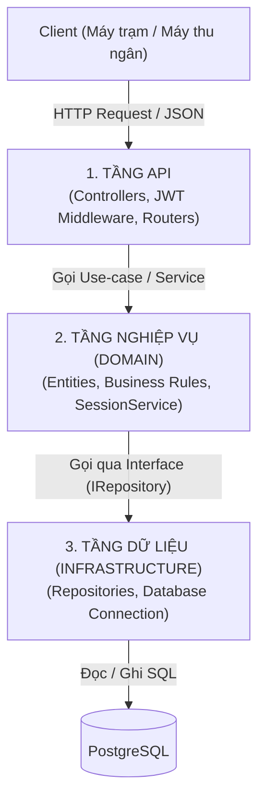
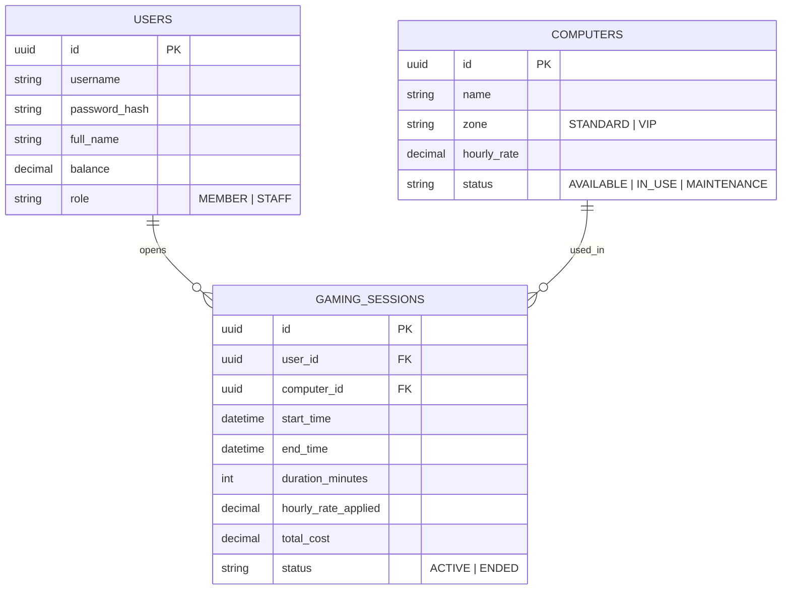

# Hệ thống Quản lý Quán Net (Cyber Café Management System) - Pha 1

Hệ thống backend quản lý máy trạm, số dư hội viên và phiên chơi của quán net theo mô hình kiến trúc phân tầng.

---

## 1. Mô tả bài toán và Nghiệp vụ cơ bản

Hệ thống đáp ứng các nghiệp vụ vận hành hàng ngày của một phòng máy:

1. **Quản lý tài khoản & Nạp tiền:**
   - Hội viên đăng nhập (`login`) để sử dụng dịch vụ và đăng xuất (`logout`) khi rời quán.
   - Hội viên có thể tra cứu số dư tài khoản hiện tại.
   - Thu ngân (`STAFF`) có quyền nạp tiền vào tài khoản cho hội viên tại quầy.
2. **Xem tình trạng phòng máy:**
   - Khách xem danh sách máy, phân loại phòng (Thường / VIP), cấu hình máy, đơn giá theo giờ và trạng thái máy (`AVAILABLE`, `IN_USE`, `MAINTENANCE`).
3. **Mở máy (Bắt đầu phiên chơi):**
   - Hội viên ngồi vào máy và gửi yêu cầu mở máy.
   - **Quy tắc kiểm tra:**
     - Máy phải đang ở trạng thái trống (`AVAILABLE`).
     - Hội viên chưa có phiên chơi nào khác đang hoạt động.
     - Số dư tài khoản phải đủ chơi tối thiểu **30 phút** của máy đó.
   - Khi hợp lệ: Máy chuyển sang `IN_USE`, hệ thống ghi nhận thời gian bắt đầu.
4. **Theo dõi và kết thúc phiên chơi:**
   - Trong khi chơi: Máy trạm tra cứu thời gian đã ngồi, số tiền tạm tính và số dư còn lại.
   - Khi kết thúc: Hội viên bấm tắt máy hoặc thu ngân tắt từ máy chủ. Hệ thống tính tiền theo số phút thực tế:
     $$\text{Tiền giờ} = \text{Số phút đã chơi} \times \left(\frac{\text{Giá một giờ}}{60}\right)$$
   - Khấu trừ số dư tài khoản, chuyển máy về trạng thái `AVAILABLE`.
   - Lưu lại lịch sử phiên chơi để hội viên tra cứu khi cần.

---

## 2. Kiến trúc Hệ thống

### 2.1. Kiến trúc phân tầng

Hệ thống được chia thành 3 tầng chức năng độc lập:



### 2.2. Mô hình Dữ liệu (ERD)



---

## 3. Đặc tả các API

* **Base URL:** `/api/v1`
* **Format dữ liệu:** `application/json`
* **Xác thực:** Gửi kèm header `Authorization: Bearer <access_token>` đối với các route yêu cầu đăng nhập.

### Bảng tổng hợp Endpoint

| Nhóm | Phương thức | Đường dẫn | Quyền hạn | Mô tả |
| :--- | :---: | :--- | :---: | :--- |
| **Xác thực** | `POST` | `/auth/login` | Public | Đăng nhập tài khoản lấy Access Token |
| | `POST` | `/auth/logout` | **Auth** | Đăng xuất, vô hiệu hóa phiên làm việc |
| **Hội viên** | `GET` | `/users/me` | **Auth** | Xem thông tin cá nhân và số dư hiện tại |
| | `POST` | `/users/{id}/top-up` | **STAFF** | Thu ngân nạp tiền vào tài khoản hội viên |
| **Máy trạm** | `GET` | `/computers` | Public | Xem danh sách và trạng thái phòng máy |
| | `GET` | `/computers/{id}` | Public | Xem chi tiết cấu hình và giá của 1 máy |
| **Phiên chơi** | `POST` | `/sessions` | **Auth** | Mở máy / Bắt đầu phiên chơi |
| | `GET` | `/sessions/me` | **Auth** | Xem thông tin phiên đang chơi hiện tại |
| | `DELETE`| `/sessions/{id}` | **Auth** | Tắt máy / Kết thúc phiên chơi tính tiền |
| | `GET` | `/sessions/history` | **Auth** | Xem lịch sử các phiên chơi trước đây |

---

### Chi tiết các Endpoint

#### 1. Đăng nhập (`POST /auth/login`)
* **Request Body:**
```json
{
  "username": "gamer01",
  "password": "Password123@"
}
```
* **Response `200 OK`:**
```json
{
  "accessToken": "eyJhbGciOiJIUzI1NiIsInR5cCI6IkpXVCJ9...",
  "user": {
    "id": "u-01",
    "username": "gamer01",
    "fullName": "Nguyen Van A",
    "balance": 50000.0,
    "role": "MEMBER"
  }
}
```
* **Lỗi:** `401 Unauthorized` (Sai tài khoản hoặc mật khẩu).

---

#### 2. Đăng xuất (`POST /auth/logout`)
* **Headers:** `Authorization: Bearer <token>`
* **Response `200 OK`:**
```json
{
  "message": "Đăng xuất thành công."
}
```

---

#### 3. Xem thông tin cá nhân & Số dư (`GET /users/me`)
* **Headers:** `Authorization: Bearer <token>`
* **Response `200 OK`:**
```json
{
  "id": "u-01",
  "username": "gamer01",
  "fullName": "Nguyen Van A",
  "balance": 50000.0,
  "role": "MEMBER"
}
```

---

#### 4. Nạp tiền vào tài khoản (`POST /users/{id}/top-up`)
* **Quyền hạn:** Chỉ tài khoản có `role = 'STAFF'` mới được gọi.
* **Headers:** `Authorization: Bearer <staff_token>`
* **Request Body:**
```json
{
  "amount": 50000.0
}
```
* **Response `200 OK`:**
```json
{
  "userId": "u-01",
  "username": "gamer01",
  "addedAmount": 50000.0,
  "newBalance": 100000.0
}
```
* **Lỗi:** `400 Bad Request` (Số tiền nạp $\le 0$), `403 Forbidden` (Không phải STAFF).

---

#### 5. Xem danh sách máy (`GET /computers`)
* **Query Params (Tùy chọn):** `status=AVAILABLE`, `zone=VIP`
* **Response `200 OK`:**
```json
[
  {
    "id": "c-01",
    "name": "Máy 01",
    "zone": "STANDARD",
    "hourlyRate": 10000.0,
    "status": "AVAILABLE"
  },
  {
    "id": "c-02",
    "name": "Máy VIP 01",
    "zone": "VIP",
    "hourlyRate": 20000.0,
    "status": "IN_USE"
  }
]
```

---

#### 6. Xem chi tiết 1 máy (`GET /computers/{id}`)
* **Response `200 OK`:**
```json
{
  "id": "c-01",
  "name": "Máy 01",
  "zone": "STANDARD",
  "hourlyRate": 10000.0,
  "status": "AVAILABLE"
}
```
* **Lỗi:** `404 Not Found` (Máy không tồn tại).

---

#### 7. Mở máy / Bắt đầu phiên chơi (`POST /sessions`)
* **Headers:** `Authorization: Bearer <token>`
* **Request Body:**
```json
{
  "computerId": "c-01"
}
```
* **Response `201 Created`:**
```json
{
  "sessionId": "s-101",
  "computerName": "Máy 01",
  "startTime": "2026-10-15T08:00:00Z",
  "hourlyRate": 10000.0,
  "userBalance": 50000.0,
  "status": "ACTIVE"
}
```
* **Lỗi:**
  * `409 Conflict`: Máy đang có người ngồi hoặc tài khoản đang mở máy khác.
  * `422 Unprocessable Entity`: Số dư không đủ tối thiểu 30 phút tiền máy.

---

#### 8. Xem phiên đang chơi của bản thân (`GET /sessions/me`)
* **Headers:** `Authorization: Bearer <token>`
* **Response `200 OK`:**
```json
{
  "sessionId": "s-101",
  "computerName": "Máy 01",
  "startTime": "2026-10-15T08:00:00Z",
  "playedMinutes": 45,
  "currentCost": 7500.0,
  "remainingBalance": 42500.0,
  "status": "ACTIVE"
}
```
* **Lỗi:** `404 Not Found` (Không có phiên chơi nào đang chạy).

---

#### 9. Tắt máy / Kết thúc phiên chơi (`DELETE /sessions/{id}`)
* **Headers:** `Authorization: Bearer <token>`
* **Response `200 OK`:**
```json
{
  "sessionId": "s-101",
  "computerName": "Máy 01",
  "startTime": "2026-10-15T08:00:00Z",
  "endTime": "2026-10-15T09:15:00Z",
  "durationMinutes": 75,
  "totalCost": 12500.0,
  "remainingBalance": 37500.0,
  "status": "ENDED"
}
```
* **Lỗi:** `403 Forbidden` (Cố ý tắt máy người khác), `400 Bad Request` (Phiên đã kết thúc).

---

#### 10. Xem lịch sử phiên chơi (`GET /sessions/history`)
* **Headers:** `Authorization: Bearer <token>`
* **Response `200 OK`:**
```json
[
  {
    "sessionId": "s-099",
    "computerName": "Máy 02",
    "startTime": "2026-10-14T14:00:00Z",
    "endTime": "2026-10-14T16:00:00Z",
    "durationMinutes": 120,
    "totalCost": 20000.0,
    "status": "ENDED"
  }
]
```


---

## 4. Định hướng Cải tiến Kiến trúc (Pha 2)

Hệ thống được thiết kế để chuẩn bị cho việc kiểm thử tải (benchmark) trên Kaggle CPU qua 3 chỉ số: **Throughput (RPS)**, **Latency (p95)** và **Tỷ lệ lỗi (%)**:

1. **In-Memory Cache (Redis) cho `GET /computers`:**
   - *Vấn đề Pha 1:* Đọc danh sách máy trực tiếp từ PostgreSQL làm nghẽn CPU database khi nhiều client gọi liên tục.
   - *Cải tiến Pha 2:* Áp dụng Redis Cache-Aside (TTL 5s–10s), xóa cache khi mở/tắt máy.
2. **Khóa chống tranh chấp máy khi mở phiên (`POST /sessions`):**
   - *Vấn đề Pha 1:* Nhiều người cùng bấm mở 1 máy tại cùng một thời điểm dễ gây Deadlock hoặc mở đè phiên.
   - *Cải tiến Pha 2:* Dùng Distributed Lock (Redis) hoặc Optimistic Locking (cột `version`) tại tầng Domain, trả về `409 Conflict` nhất quán cho các request sau.
3. **Ghi nhận dữ liệu bất đồng bộ qua Queue (RabbitMQ / Redis):**
   - *Vấn đề Pha 1:* Cập nhật phút chơi và trừ tiền liên tục xuống DB gây nghẽn đĩa cứng (Disk I/O).
   - *Cải tiến Pha 2:* Tạm tính trên Redis, dùng worker gom mẻ (batching) ghi về PostgreSQL mỗi 1–3 phút.
4. **Rate Limiting bảo vệ hệ thống:**
   - *Vấn đề Pha 1:* Chưa có cơ chế chặn spam hoặc client lỗi gửi lặp vô hạn.
   - *Cải tiến Pha 2:* Bổ sung middleware Rate Limiting theo IP/User (Token Bucket) để giữ vững tính sẵn sàng của hệ thống.
