# Hệ thống Đặt hàng Flash Sale - Pha 1

## 1. Mô tả bài toán và nghiệp vụ cơ bản

Hệ thống phục vụ các chiến dịch bán hàng Flash Sale. Điểm khó khăn chính của bài toán là xử lý lượng truy cập đồng thời lớn khi nhiều khách hàng cùng tranh mua một số lượng hàng hóa có hạn, đòi hỏi tính nhất quán của dữ liệu tồn kho và thời gian phản hồi nhanh.

| Role     | Nghiệp vụ                                                                                                             |
| :------- | :-------------------------------------------------------------------------------------------------------------------- |
| Customer | Xem danh sách và chi tiết các sản phẩm Flash Sale, đặt mua sản phẩm, xem lịch sử đơn hàng của bản thân, hủy đơn hàng. |
| Admin    | Thêm/xóa sản phẩm trong danh sách Flash Sale                                                                          |

Nghiệp vụ cơ bản:

- Khách hàng có thể xem danh sách, chi tiết sản phẩm Flash Sale và lọc danh sách theo từ khóa, khoảng giá, tình trạng tồn kho hoặc trạng thái chương trình.

- Sản phẩm có thời gian bắt đầu, thời gian kết thúc và trạng thái. Hệ thống xác định trạng thái mở bán dựa trên thời gian, trạng thái sản phẩm và số lượng tồn kho.

- Admin có thể thêm, cập nhật thông tin và xóa sản phẩm. Việc điều chỉnh tồn kho được thực hiện qua chức năng riêng.

- Khách hàng chọn sản phẩm và số lượng muốn mua. Mỗi đơn hàng có tối đa 20 sản phẩm. Hệ thống kiểm tra trạng thái Flash Sale và tồn kho trước khi đặt hàng:

  - Nếu chương trình đang mở bán và còn đủ hàng: Hệ thống giữ số lượng tồn kho và tạo đơn hàng ở trạng thái `PENDING`.

  - Nếu chương trình chưa bắt đầu, đã kết thúc, sản phẩm ngừng bán hoặc hết hàng: Từ chối yêu cầu và trả về lỗi.

- Khách hàng có thể xem danh sách đơn hàng, lọc theo trạng thái, phân trang và xem thống kê đơn hàng của bản thân.

- Khách hàng chỉ có thể hủy đơn hàng ở trạng thái `PENDING`. Khi hủy thành công, số lượng tương ứng được hoàn lại vào kho hàng.

## 2. Kiến trúc hệ thống

### 2.1. Kiến trúc phân tầng

```mermaid
flowchart TB
    Client(["Client"])
    subgraph Presentation["Presentation Layer"]
        AuthAPI["Auth API"]
        ProductAPI["Product API"]
        OrderAPI["Order API"]
    end
    subgraph Business["Business Layer"]
        AuthService["Auth Service"]
        ProductService["Product Service"]
        OrderService["Order Service"]
    end
    subgraph Persistence["Persistence Layer"]
        UserRepo["User Repository"]
        ProductRepo["Product Repository"]
        OrderRepo["Order Repository"]
    end
    DB[("PostgreSQL")]
    Client --> AuthAPI
    Client --> ProductAPI
    Client --> OrderAPI
    AuthAPI --> AuthService
    ProductAPI --> ProductService
    OrderAPI --> OrderService
    AuthService --> UserRepo
    ProductService --> ProductRepo
    OrderService --> ProductRepo
    OrderService --> OrderRepo
    UserRepo --> DB
    ProductRepo --> DB
    OrderRepo --> DB
```



- Presentation Layer: nhận yêu cầu về tài khoản, sản phẩm và đơn hàng; kiểm tra đầu vào, xác thực/phân quyền và trả phản hồi.

- Business Layer: Xử lý logic nghiệp vụ như quản lý trạng thái Flash Sale, kiểm tra tồn kho, tính tổng tiền, lọc sản phẩm/đơn hàng và hoàn kho khi hủy đơn.

- Persistence Layer: Chịu trách nhiệm quản lý và tương tác với cơ sở dữ liệu PostgreSQL.

### 2.2. Tổ chức mã nguồn

Framework: FastAPI

| Thư viện          | Vai trò                                       |
| :---------------- | :-------------------------------------------- |
| Uvicorn           | Chạy ứng dụng FastAPI.                        |
| Pydantic          | Định nghĩa schema.                            |
| SQLAlchemy        | Ánh xạ bảng, truy vấn và quản lý transaction. |
| Psycopg           | Kết nối PostgreSQL.                           |
| Python JOSE       | Tạo và xác minh JWT.                          |
| Passlib và bcrypt | Băm và kiểm tra mật khẩu.                     |

```text
app/
├── api/                        Presentation Layer
│   ├── v1/
│   │   ├── router.py           Tổng hợp các router
│   │   ├── auth.py             Đăng nhập, đăng xuất và thông tin cá nhân
│   │   ├── products.py         API sản phẩm
│   │   └── orders.py           API đơn hàng
│   ├── schemas.py              Schema request/response
│   └── dependencies.py         Cung cấp dependency, xác thực và phân quyền
├── services/                   Business Layer: xử lý nghiệp vụ
│   ├── auth_service.py         Xác thực người dùng
│   ├── product_service.py      Quản lý sản phẩm
│   └── order_service.py        Đặt và hủy đơn hàng
├── domain/                     Business Layer: các định nghĩa nghiệp vụ
│   ├── models.py               Entity người dùng, sản phẩm và đơn hàng
│   ├── repositories.py         Interface repository
│   └── exceptions.py           Lỗi nghiệp vụ
├── infrastructure/             Persistence Layer
│   ├── models.py               ORM model
│   └── repositories.py         Repository SQLAlchemy
├── core/                       Các thành phần hỗ trợ
│   ├── config.py               Cấu hình ứng dụng
│   ├── database.py             Kết nối và session CSDL
│   └── security.py             Mật khẩu và JWT
└── main.py                     Khởi tạo ứng dụng và đăng ký router
```

## 3. Đặc tả các REST API

- Đặc tả OpenAPI: [openapi.json](openapi.json).

- Xem và thử API bằng Swagger UI: [http://localhost:8000/docs](http://localhost:8000/docs) sau khi khởi động hệ thống.

- Base URL: `/api/v1`

- Xác thực: Gửi kèm header `Authorization: Bearer <access_token>` đối với các route yêu cầu xác thực.

### Bảng tổng hợp các endpoint

| Nhóm           | Method   | Đường dẫn                              | Quyền hạn    | Mô tả chức năng                                               |
| :------------- | :------- | :------------------------------------- | :----------- | :------------------------------------------------------------ |
| **Auth**       | `POST`   | `/auth/login`                          | Public       | Đăng nhập                                                     |
|                | `POST`   | `/auth/logout`                         | Auth         | Đăng xuất                                                     |
|                | `GET`    | `/users/me`                            | Auth         | Xem thông tin chi tiết của tài khoản                          |
| **Flash Sale** | `GET`    | `/products`                            | Public       | Xem và lọc danh sách sản phẩm Flash Sale                      |
|                | `GET`    | `/products/{id}`                       | Public       | Xem thông tin chi tiết và số lượng tồn kho của 1 sản phẩm     |
|                | `POST`   | `/products`                            | Admin        | Thêm mới một sản phẩm vào danh sách Flash Sale                |
|                | `PATCH`  | `/products/{product_id}`               | Admin        | Cập nhật thông tin sản phẩm                                   |
|                | `POST`   | `/products/{product_id}/stock-adjustments` | Admin    | Điều chỉnh số lượng tồn kho                                   |
|                | `DELETE` | `/products/{id}`                       | Admin        | Xóa một sản phẩm khỏi danh sách Flash Sale                    |
| **Orders**     | `POST`   | `/orders`                              | Customer     | Đặt mua sản phẩm Flash Sale                                   |
|                | `GET`    | `/orders`                              | Customer     | Xem, lọc và phân trang danh sách đơn hàng của người dùng hiện tại |
|                | `GET`    | `/orders/summary`                      | Customer     | Xem thống kê đơn hàng của người dùng hiện tại                 |
|                | `GET`    | `/orders/{id}`                         | Customer     | Xem chi tiết thông tin một đơn hàng                           |
|                | `POST`   | `/orders/{id}/cancel`                  | Customer     | Hủy đơn hàng                                                  |
| **Hệ thống**   | `GET`    | `/health`                              | Public       | Kiểm tra trạng thái hoạt động của Backend và kết nối Database |

### Các tham số lọc và phân trang

- `GET /products` hỗ trợ các tham số `keyword`, `min_price`, `max_price`, `in_stock_only` và `sale_state`. `keyword` tìm không phân biệt chữ hoa/thường trong tên và mô tả; khoảng giá áp dụng trên giá Flash Sale. `sale_state` nhận một trong các giá trị `UPCOMING`, `AVAILABLE`, `SOLD_OUT`, `ENDED`, `INACTIVE`. Danh sách hiện chỉ truy vấn sản phẩm `ACTIVE`, nên bộ lọc `INACTIVE` không trả về sản phẩm.
- `GET /orders` hỗ trợ `status`, `offset` và `limit`. `status` nhận `PENDING`, `CONFIRMED`, `COMPLETED` hoặc `CANCELLED`; `offset` mặc định là 0 và không âm; `limit` mặc định là 20, từ 1 đến 100. Kết quả được sắp xếp theo thời gian tạo mới nhất trước.
- Người dùng chỉ xem được đơn hàng của chính mình. Các endpoint quản lý sản phẩm yêu cầu quyền Admin.
- `GET /orders/summary` trả về `total_orders`, `pending_orders`, `completed_orders`, `cancelled_orders` và `total_spent`. `total_spent` không tính các đơn `CANCELLED`, còn `total_orders` vẫn tính cả đơn đã hủy.

### Quy tắc nghiệp vụ chính

- Khi cập nhật sản phẩm, các trường được hỗ trợ gồm `name`, `description`, `original_price`, `flash_sale_price`, `start_time`, `end_time` và `status`. Không cập nhật tồn kho qua endpoint này.
- Tên sản phẩm sau chuẩn hóa dài từ 1 đến 200 ký tự. Giá phải dương, tối đa hai chữ số thập phân và giá Flash Sale phải thấp hơn giá gốc. Thời gian kết thúc phải sau thời gian bắt đầu khi cả hai cùng được cung cấp. `status` chỉ nhận `ACTIVE` hoặc `INACTIVE`.
- Điều chỉnh tồn kho dùng body `{"adjustment": số_nguyên}`. Giá trị dương là nhập thêm, giá trị âm là xuất bớt. Không chấp nhận giá trị 0, xuất vượt tồn kho hoặc để tồn kho vượt quá 1.000.000.
- Khi đặt hàng, hệ thống cập nhật tồn kho với điều kiện số lượng hiện có phải đủ. Nếu ghi đơn thất bại sau bước giữ kho, service thực hiện hoàn kho. Các thao tác giữ kho, ghi đơn và hoàn kho được commit riêng, không phải một transaction nguyên tử bao trùm toàn bộ quy trình.
- Chỉ chủ đơn mới được hủy và chỉ đơn `PENDING` được hủy. Hệ thống chuyển trạng thái đơn sang `CANCELLED` trước, sau đó hoàn kho. Nếu bước hoàn kho thất bại, yêu cầu trả lỗi; trạng thái đơn đã được commit là `CANCELLED`.

## 4. Hướng dẫn chạy dự án

### Cách 1: Sử dụng Docker Compose

Yêu cầu: Đã cài đặt Docker và Docker Compose.

1. Khởi động toàn bộ hệ thống:

```bash
docker compose up --build
```

2. Truy cập tài liệu API:

- Đường dẫn: `http://localhost:8000/docs`

- Tài khoản thử nghiệm:

  - Quản trị viên: `admin` / `admin123`

  - Khách hàng: `customer1` / `password123`

### Cách 2: Chạy trực tiếp bằng Python

Yêu cầu: Python 3.10+ và PostgreSQL đang chạy.

1. Cài đặt thư viện:

```bash
pip install -r requirements.txt
```

2. Thiết lập cấu hình:

- Sao chép `.env.example` thành `.env` và cập nhật thông tin `DATABASE_URL`.

3. Khởi tạo dữ liệu thử nghiệm:

```bash
python -m scripts.seed
```

4. Khởi chạy server:

```bash
uvicorn app.main:app --reload
```

## 5. Kết quả kiểm thử thực tế trên Kaggle

### 5.1. Tổng quan môi trường kiểm thử

- Cấu hình: Kaggle CPU, Accelerator: None, Internet on.

- Kiểm thử trên endpoint `POST /api/v1/orders`, timeout mỗi request 60 giây.

- Mỗi mức tải được chạy 3 lần độc lập; bảng kết quả ghi khoảng giá trị nhỏ nhất, lớn nhất của 3 lần.

- Chỉ số đánh giá:

  - HTTP 201: số request tạo đơn thành công; HTTP 500: số request server trả lỗi nội bộ.

  - Timeout: số request không nhận được phản hồi sau 60 giây.

  - Tồn kho thực tế: số lượng tồn kho còn lại của sản phẩm sau khi chạy; Đơn trong DB: số đơn hàng thực tế được ghi nhận trogn DB.

  - p95: thời gian phản hồi mà 95% request nhanh hơn hoặc bằng, tính cả request timeout.

### 5.2. Kịch bản thứ 1

Kịch bản kiểm thử:

- Khởi tạo một sản phẩm có số lượng tồn kho là 100.

- Gửi đồng thời 20 request đặt mua sản phẩm.

- Kiểm tra số đơn hàng được tạo và số lượng tồn kho còn lại.

| Request đồng thời | Đơn trong DB | Tồn kho mong đợi | Tồn kho thực tế |
| ----------------: | -----------: | ---------------: | --------------: |
|                20 |           20 |               80 |         95 – 96 |

Hệ thống chưa đảm bảo tính nhất quán của dữ liệu tồn kho khi xử lý các request đặt hàng đồng thời.

### 5.3. Kịch bản thứ 2

Kịch bản kiểm thử:

- Khởi tạo một sản phẩm có số lượng tồn kho là 10000 cho mỗi mức tải.

- Gửi tổng cộng 1000 request đặt mua sản phẩm, lần lượt với 10, 50, 100 và 200 client.

- Kiểm tra kết quả xử lý, thời gian phản hồi và số lượng tồn kho còn lại. Nếu tạo đủ 1000 đơn thì số lượng hàng tồn kho phải còn 9000.

| Client đồng thời | HTTP 201 | HTTP 500 |   Timeout | Đơn trong DB | Tồn kho mong đợi | Tồn kho thực tế |      p95 (ms) |
| ---------------: | -------: | -------: | --------: | -----------: | ---------------: | --------------: | ------------: |
|               10 |     1000 |        0 |         0 |         1000 |             9000 |     9538 – 9559 |     128 – 162 |
|               50 |     1000 |        0 |         0 |         1000 |             9000 |     9776 – 9793 |     751 – 871 |
|              100 |  10 – 18 | 86 – 102 | 865 – 881 |    271 – 287 |      9713 – 9729 |     9903 – 9913 | 60121 – 60139 |
|              200 |        0 |       40 | 950 – 955 |          --- |              --- |             --- | 60225 – 60347 |

Tồn kho mong đợi = 10000 − số đơn hàng thực tế được lưu.

Nhận xét:

- Ở mức 10 và 50 client, tất cả request đều thành công nhưng tồn kho vẫn bị trừ thiếu ở cả 3 lần chạy.

- Ở mức 100 client, phần lớn request bị lỗi hoặc timeout, p95 vượt 60 giây.

- Ở mức 200 client, không request nào thành công.

Khi số lượng request đặt hàng đồng thời tăng cao, hệ thống phản hồi chậm, khả năng xử lý chưa ổn định và dữ liệu tồn kho không còn chính xác.

## 6. Vấn đề dễ thấy và hướng cải tiến Phase 2

| Nội dung | Vấn đề ở Phase 1 | Hướng cải tiến Phase 2 |
| :--- | :--- | :--- |
| Tính nhất quán dữ liệu khi xử lý đồng thời | Code hiện tại đã dùng cập nhật tồn kho có điều kiện để tránh trừ kho vượt số lượng còn lại. Tuy nhiên, bước giữ kho và ghi đơn vẫn commit riêng, nên chưa bảo đảm toàn bộ quy trình là một transaction nguyên tử. Các kết quả kiểm thử tải bên trên chưa xác nhận cơ chế mới. | Áp dụng cập nhật kho nguyên tử tại database và quản lý trừ kho, tạo đơn trong cùng một giao dịch. Đánh giá bằng đối soát dữ liệu sau mỗi mức tải: tổng số lượng đã bán cộng tồn kho còn lại phải bằng tồn kho ban đầu trong kịch bản chỉ đặt hàng. |
| Độ tin cậy khi gửi lại yêu cầu | Khi mạng chậm hoặc client timeout, khách có thể gửi lại yêu cầu dù lần trước vẫn đang được xử lý. Hai kịch bản hiện tại chưa đánh giá khả năng duy trì một kết quả giao dịch thống nhất trong tình huống này. | Dùng mã định danh yêu cầu để nhận biết các lần gửi lại của cùng một thao tác và trả về cùng kết quả. Kiểm thử gửi lặp khi đặt/hủy đơn và khi timeout, bảo đảm mỗi thao tác chỉ làm thay đổi đơn hàng, tồn kho một lần. |
| Khả năng mở rộng | Notebook hiện chỉ kiểm thử backend với 1 worker, nên chưa đánh giá được hiệu quả khi chạy nhiều tiến trình hoặc nhiều máy chủ. Mọi yêu cầu trong mỗi lượt đều mua cùng một sản phẩm, vì vậy mở rộng backend vẫn phải giải quyết việc cùng cập nhật một dòng tồn kho. | Thử tăng số worker, sau đó đánh giá chạy nhiều máy chủ và phân phối yêu cầu giữa chúng. Điều chỉnh tổng số kết nối phù hợp với khả năng database. So sánh riêng từng cấu hình để xác định có phục vụ thêm người mua hay không, đồng thời kiểm tra kho vẫn chính xác. |
| Bảo mật khi vận hành | Phase 1 sử dụng cấu hình và tài khoản thử nghiệm; các kịch bản hiện tại tập trung vào đặt hàng, chưa đánh giá mức bảo vệ trước việc dò mật khẩu hoặc gửi yêu cầu liên tục. Cần bổ sung đánh giá bảo mật trước khi vận hành thực tế. | Quản lý khóa ký token và mật khẩu database bằng cấu hình riêng cho từng môi trường; giới hạn tần suất đăng nhập và yêu cầu theo chính sách. Kiểm thử khả năng ngăn chặn lạm dụng, đồng thời bảo đảm người dùng hợp lệ vẫn sử dụng được hệ thống. |
| Khả năng phục hồi khi có sự cố | Các ca tải cao ghi nhận nhiều timeout; khả năng trở lại hoạt động ổn định sau quá tải, mất kết nối database hoặc khởi động lại chưa được hai kịch bản hiện tại đánh giá. | Bổ sung theo dõi trạng thái sẵn sàng, thời gian chờ có giới hạn và cách tra cứu kết quả sau timeout. Thử ngắt kết nối, khởi động lại và giảm tải để đo thời gian phục hồi, đối soát dữ liệu. Chuẩn bị sao lưu và thử khôi phục để đánh giá khả năng bảo toàn dữ liệu khi có sự cố. |
