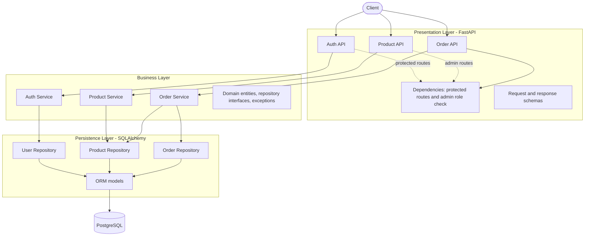

# Hệ thống Đặt hàng Flash Sale - Pha 1
# Hệ thống Đặt hàng Flash Sale

## 1. Mô tả bài toán và nghiệp vụ cơ bản

Hệ thống phục vụ các chiến dịch bán hàng Flash Sale. Điểm khó khăn chính của bài toán là xử lý lượng truy cập đồng thời lớn khi nhiều khách hàng cùng tranh mua một số lượng hàng hóa có hạn, đòi hỏi tính nhất quán của dữ liệu tồn kho và thời gian phản hồi nhanh.
Hệ thống cung cấp REST API cho các chiến dịch Flash Sale, gồm quản lý sản phẩm và lịch bán, đặt/hủy đơn hàng, kiểm soát tồn kho và xem thống kê đơn hàng. Bài toán cần duy trì tính đúng đắn của tồn kho khi nhiều khách hàng đồng thời đặt mua sản phẩm giới hạn.

| Vai trò | Nghiệp vụ đã triển khai |
| :-- | :-- |
| Customer | Xem chi tiết và tìm kiếm/lọc danh sách sản phẩm; đặt hàng; xem, lọc, phân trang đơn hàng của chính mình; xem thống kê đơn hàng; hủy đơn đang `PENDING`. |
| Admin | Tạo, cập nhật, xóa sản phẩm; thiết lập lịch và trạng thái Flash Sale; điều chỉnh tồn kho. |
| Public | Đăng nhập và kiểm tra trạng thái backend/kết nối database. |

### 1.1. Trạng thái Flash Sale

`Product.sale_state()` xác định trạng thái theo thứ tự sau:

1. `INACTIVE`: trạng thái sản phẩm khác `ACTIVE`.
2. `UPCOMING`: có `start_time` và thời điểm hiện tại còn trước thời gian bắt đầu.
3. `ENDED`: có `end_time` và thời điểm hiện tại đã đến hoặc vượt thời gian kết thúc.
4. `SOLD_OUT`: tồn kho nhỏ hơn hoặc bằng 0.
5. `AVAILABLE`: các trường hợp còn lại.

Danh sách sản phẩm chỉ truy vấn sản phẩm `ACTIVE`. Do đó, dù bộ lọc `sale_state` chấp nhận `INACTIVE`, danh sách hiện không thể trả sản phẩm INACTIVE.

### 1.2. Quản lý sản phẩm

- Admin tạo sản phẩm ở trạng thái ban đầu `ACTIVE`; có thể cập nhật tên, mô tả, giá, lịch và trạng thái một phần qua `PATCH /api/v1/products/{product_id}`.
- Tồn kho được thay đổi riêng qua `POST /api/v1/products/{product_id}/stock-adjustments`; số điều chỉnh dương là nhập thêm, âm là xuất bớt. Không chấp nhận 0, không cho phép kết quả âm và endpoint điều chỉnh giới hạn tồn kho sau cập nhật ở mức 1.000.000. Giới hạn này không được kiểm tra khi tạo sản phẩm.
- Tên sản phẩm được chuẩn hóa khoảng trắng, dài từ 1 đến 200 ký tự. Giá gốc và giá Flash Sale phải dương, tối đa hai chữ số thập phân; giá Flash Sale phải thấp hơn giá gốc.
- Nếu cả `start_time` và `end_time` có giá trị, thời gian kết thúc phải sau thời gian bắt đầu.
- Không thể xóa sản phẩm đang được đơn hàng tham chiếu; API trả `409 Conflict`.

### 1.3. Đặt hàng và hủy đơn

- Mỗi đơn nhận số lượng nguyên từ 1 đến tối đa 20 sản phẩm.
- Khi đặt hàng, hệ thống kiểm tra sản phẩm tồn tại và còn `ACTIVE`, Flash Sale đã bắt đầu và chưa kết thúc, sản phẩm chưa hết hàng và tồn kho đủ số lượng.
- Giữ kho dùng câu cập nhật có điều kiện tại database, chỉ trừ khi `stock >= quantity`. Nếu thao tác không cập nhật được dòng sản phẩm, yêu cầu bị từ chối do không đủ tồn kho.
- Đơn mới có trạng thái `PENDING`. Giá đơn vị được lấy từ giá Flash Sale tại thời điểm đặt hàng; tổng tiền được tính từ giá này và số lượng.
- **Giữ kho và ghi đơn commit riêng biệt, không phải một transaction nguyên tử.** Nếu ghi đơn thất bại, service gọi thao tác hoàn lại số lượng đã giữ như một bước bù trừ riêng.
- Chỉ chủ đơn được hủy và chỉ đơn `PENDING` được hủy. Hệ thống chuyển trạng thái có điều kiện sang `CANCELLED` và commit trước, sau đó mới hoàn kho.
- Nếu chuyển trạng thái không thành công do yêu cầu cạnh tranh, kho không được hoàn. Nếu hoàn kho thất bại sau khi trạng thái đã commit `CANCELLED`, API trả lỗi; service không tự hoàn lại lần nữa nhằm tránh cộng kho lặp khi client gửi lại yêu cầu.

### 1.4. Lọc, phân trang và thống kê đơn hàng

- Danh sách sản phẩm hỗ trợ tìm không phân biệt hoa thường trong tên/mô tả (`keyword`), lọc khoảng giá Flash Sale (`min_price`, `max_price`), chỉ sản phẩm còn hàng (`in_stock_only`) và trạng thái Flash Sale (`sale_state`). Giá tối thiểu không được lớn hơn giá tối đa.
- `GET /api/v1/orders` chỉ trả đơn của người dùng hiện tại, sắp xếp `created_at` giảm dần; hỗ trợ lọc `status` và phân trang bằng `offset`/`limit`. Trạng thái hợp lệ là `PENDING`, `CONFIRMED`, `COMPLETED`, `CANCELLED` (không phân biệt hoa thường); `offset >= 0`, `limit` từ 1 đến 100.
- `GET /api/v1/orders/summary` trả tổng số đơn, số đơn `PENDING`, `COMPLETED`, `CANCELLED` và `total_spent`. `total_spent` cộng giá trị các đơn không `CANCELLED`, kể cả đơn `PENDING`; `total_orders` vẫn tính đơn đã hủy. Đây là tổng theo dữ liệu đơn, không phải tổng tiền đã thanh toán.

## 2. Kiến trúc hệ thống

### 2.1. Kiến trúc phân tầng

Hệ thống tổ chức theo luồng API → nghiệp vụ → truy cập dữ liệu:



- **Presentation:** router FastAPI tiếp nhận request và trả response; schema Pydantic khai báo body/query/response; dependency cung cấp repository/service, xác thực JWT và kiểm tra role `ADMIN` ở router quản trị.
- **Business:** service thực hiện quy tắc nghiệp vụ sản phẩm, đơn hàng, tồn kho và thống kê. Domain định nghĩa entity, repository interface và exception; layer này không import framework web hoặc thư viện DB.
- **Persistence:** SQLAlchemy model ánh xạ bảng; repository triển khai interface, truy vấn PostgreSQL và thực hiện commit.

**Luồng đặt hàng:** API lấy người dùng đã xác thực → `OrderService` kiểm tra số lượng, trạng thái Flash Sale và tồn kho → `ProductRepository.reserve_stock()` cập nhật kho có điều kiện rồi commit → `OrderRepository.create()` ghi đơn rồi commit. Nếu ghi đơn lỗi, service gọi `ProductRepository.release_stock()` để hoàn kho và commit riêng.

**Luồng hủy:** API lấy người dùng đã xác thực → service kiểm tra đơn, quyền sở hữu, trạng thái `PENDING` và sản phẩm → `OrderRepository.transition_status()` đổi `PENDING` thành `CANCELLED` có điều kiện rồi commit → `ProductRepository.release_stock()` hoàn kho và commit. Việc đổi trạng thái và hoàn kho không nằm trong cùng transaction.

### 2.2. Cấu trúc mã nguồn

```text
app/
├── api/                        Presentation Layer
│   ├── v1/                     Router auth, products, orders
│   │   └── router.py           Tổng hợp router phiên bản 1
│   ├── schemas.py              Request/response schemas
│   └── dependencies.py         Dependency injection, authentication, authorization
├── services/                   Business services
│   ├── auth_service.py         Xác thực người dùng
│   ├── product_service.py      Nghiệp vụ sản phẩm và tồn kho
│   └── order_service.py        Nghiệp vụ đặt/hủy và thống kê đơn
├── domain/                     Entity, repository interface, exception
├── infrastructure/             SQLAlchemy models và repository
├── core/                       Cấu hình, database session, mật khẩu/JWT
└── main.py                     Khởi tạo FastAPI, router và health endpoint
```

### 2.3. Công nghệ sử dụng

| Công nghệ/thư viện | Vai trò |
| :-- | :-- |
| FastAPI | REST API và dependency injection. |
| Uvicorn | ASGI server chạy ứng dụng. |
| Pydantic | Validation và request/response schemas. |
| SQLAlchemy | ORM, truy vấn và session database. |
| Psycopg / psycopg2 | Driver kết nối PostgreSQL. |
| Python JOSE | Tạo và xác minh JWT. |
| Passlib / bcrypt | Băm và xác minh mật khẩu. |
| PostgreSQL | Cơ sở dữ liệu quan hệ. |

## 3. Đặc tả REST API

- OpenAPI: [openapi.json](openapi.json).
- Swagger UI: [http://localhost:8000/docs](http://localhost:8000/docs); ReDoc: [http://localhost:8000/redoc](http://localhost:8000/redoc).
- Base path của API phiên bản 1: `/api/v1`. Health endpoint là `/health` ở root.
- Các route được bảo vệ cần header `Authorization: Bearer <access_token>`; đăng nhập, xem sản phẩm và health là public. Route quản trị sản phẩm yêu cầu role `ADMIN`. API đơn hàng yêu cầu user đã xác thực và chỉ truy cập đơn của user đó; source không kiểm tra riêng role `CUSTOMER`.
- Lỗi thường gặp: `400` cho quy tắc nghiệp vụ/filter không hợp lệ; `401` cho token thiếu/không hợp lệ hoặc đăng nhập thất bại; `403` cho sai role/quyền sở hữu; `404` khi không tìm thấy tài nguyên; `409` khi xóa sản phẩm đã có đơn tham chiếu; `422` cho validation path/query/body của FastAPI.

| Nhóm | Method | Đường dẫn | Query parameters | Quyền truy cập | Mô tả |
| :-- | :-- | :-- | :-- | :-- | :-- |
| Auth | `POST` | `/api/v1/auth/login` | — | Public | Đăng nhập và nhận access token. |
| Auth | `POST` | `/api/v1/auth/logout` | — | Auth | Trả thông báo đăng xuất; JWT stateless không bị thu hồi bởi endpoint này. |
| Users | `GET` | `/api/v1/users/me` | — | Auth | Xem hồ sơ người dùng đang đăng nhập. |
| Flash Sale | `GET` | `/api/v1/products` | `keyword`, `min_price`, `max_price`, `in_stock_only`, `sale_state` | Public | Tìm kiếm và lọc danh sách sản phẩm ACTIVE. |
| Flash Sale | `GET` | `/api/v1/products/{product_id}` | — | Public | Xem chi tiết sản phẩm và tồn kho. |
| Flash Sale | `POST` | `/api/v1/products` | — | Admin | Tạo sản phẩm Flash Sale. |
| Flash Sale | `PATCH` | `/api/v1/products/{product_id}` | — | Admin | Cập nhật một phần thông tin, không gồm tồn kho. |
| Flash Sale | `POST` | `/api/v1/products/{product_id}/stock-adjustments` | — | Admin | Tăng hoặc giảm tồn kho. |
| Flash Sale | `DELETE` | `/api/v1/products/{product_id}` | — | Admin | Xóa sản phẩm nếu không bị đơn hàng tham chiếu. |
| Orders | `POST` | `/api/v1/orders` | — | Authenticated user | Đặt hàng và tạo đơn `PENDING`. |
| Orders | `GET` | `/api/v1/orders` | `status`, `offset`, `limit` | Authenticated user | Danh sách đơn của người dùng; mới nhất trước, có lọc/phân trang. |
| Orders | `GET` | `/api/v1/orders/summary` | — | Authenticated user | Thống kê đơn và tổng giá trị đơn không bị hủy của người dùng. |
| Orders | `GET` | `/api/v1/orders/{order_id}` | — | Authenticated user | Xem chi tiết đơn của chính người dùng. |
| Orders | `POST` | `/api/v1/orders/{order_id}/cancel` | — | Authenticated user | Hủy đơn `PENDING` của chính mình và hoàn kho. |
| System | `GET` | `/health` | — | Public | Trả `status` luôn là `healthy`; `database` cho biết `connected` hoặc `disconnected`. |

`sale_state` nhận `UPCOMING`, `AVAILABLE`, `SOLD_OUT`, `ENDED`, `INACTIVE`; `status` lọc đơn nhận `PENDING`, `CONFIRMED`, `COMPLETED`, `CANCELLED`. Chi tiết request, response, validation và status code từng operation được mô tả trong OpenAPI. Source hiện không cung cấp API xác nhận hoặc hoàn thành đơn.

## 4. Hướng dẫn cài đặt và chạy

### 4.1. Docker Compose

Yêu cầu đã cài Docker và Docker Compose. Compose chạy PostgreSQL 16, chờ healthcheck DB thành công, sau đó backend chạy seed và khởi chạy Uvicorn.

```bash
docker compose up --build
```

Ứng dụng mặc định mở tại `http://localhost:8000`; Swagger UI tại `/docs`. Dừng stack bằng `Ctrl+C`; chạy `docker compose down` để gỡ container (volume dữ liệu `postgres_data` vẫn được giữ, trừ khi xóa volume).

Tài khoản thử nghiệm do seed tạo:

| Vai trò | Username | Password |
| :-- | :-- | :-- |
| Admin | `admin` | `admin123` |
| Customer | `customer1` | `password123` |

### 4.2. Chạy trực tiếp bằng Python

Yêu cầu Python 3.10 trở lên và PostgreSQL đang chạy. Tạo/kích hoạt môi trường ảo theo hệ điều hành, sau đó cài dependencies và cấu hình:

```bash
pip install -r requirements.txt
cp .env.example .env
```

Cập nhật `DATABASE_URL` trong `.env` cho PostgreSQL cục bộ. Các biến ứng dụng gồm `PROJECT_NAME`, `API_V1_STR`, `DATABASE_URL`, `SECRET_KEY`, `ALGORITHM`, `ACCESS_TOKEN_EXPIRE_MINUTES`. `.env.example` cung cấp giá trị mẫu; secret mặc định và thông tin đăng nhập seed chỉ phù hợp cho phát triển/thử nghiệm.

Khởi tạo dữ liệu thử nghiệm và chạy server:

```bash
python -m scripts.seed
uvicorn app.main:app --reload
```

Khi ứng dụng khởi động, `Base.metadata.create_all()` tạo các bảng còn thiếu. Source hiện không có migration schema.

### 4.3. Chạy test

`pytest` không nằm trong `requirements.txt`; cài thêm nếu cần rồi chạy test service/schema:

```bash
pip install pytest
python -m pytest
```

Test hiện có nằm trong `tests/services/`, bao phủ các quy tắc service sản phẩm/đơn hàng và validation schema thông qua fake repositories.

## 5. Kết quả kiểm thử tải Phase 1 trên Kaggle

Các số liệu dưới đây là kết quả kiểm thử tải Phase 1 được lưu trong README từ lần chạy trước; đây **không phải** kết quả đo của source code hiện tại. Notebook hiện có cấu hình `REPEATS = 1`, không có execution output kèm theo để xác nhận lại các số liệu này.

### 5.1. Môi trường và chỉ số

- Môi trường: Kaggle CPU, Accelerator: None, Internet on.
- Endpoint kiểm thử: `POST /api/v1/orders`; timeout mỗi request là 60 giây.
- Bảng kết quả giữ các khoảng giá trị nhỏ nhất–lớn nhất đã ghi nhận; cấu hình notebook hiện tại chưa tái lập ba lần chạy (`REPEATS = 1`).
- HTTP 201: request tạo đơn thành công; HTTP 500: request server trả lỗi nội bộ; Timeout: không nhận phản hồi trong 60 giây.
- “Đơn trong DB” là số bản ghi đơn thực tế; “Tồn kho mong đợi” = tồn ban đầu − số đơn thực tế được lưu. p95 là thời gian phản hồi mà 95% request nhanh hơn hoặc bằng, tính cả request timeout.

### 5.2. Kịch bản 1: 20 request đồng thời

Khởi tạo một sản phẩm tồn kho 100, gửi đồng thời 20 request đặt mua và kiểm tra số đơn cùng lượng tồn kho còn lại.

| Request đồng thời | Đơn trong DB | Tồn kho mong đợi | Tồn kho thực tế |
| --: | --: | --: | --: |
| 20 | 20 | 80 | 95–96 |

### 5.3. Kịch bản 2: 1.000 request với các mức client

Khởi tạo sản phẩm tồn kho 10.000 cho mỗi lượt tải; gửi tổng cộng 1.000 request với 10, 50, 100 và 200 client đồng thời.

| Client đồng thời | HTTP 201 | HTTP 500 | Timeout | Đơn trong DB | Tồn kho mong đợi | Tồn kho thực tế | p95 (ms) |
| --: | --: | --: | --: | --: | --: | --: | --: |
| 10 | 1000 | 0 | 0 | 1000 | 9000 | 9538–9559 | 128–162 |
| 50 | 1000 | 0 | 0 | 1000 | 9000 | 9776–9793 | 751–871 |
| 100 | 10–18 | 86–102 | 865–881 | 271–287 | 9713–9729 | 9903–9913 | 60121–60139 |
| 200 | 0 | 40 | 950–955 | — | — | — | 60225–60347 |

**Nhận xét:** ở mức 10 và 50 client, mọi request đều thành công nhưng tồn kho bị trừ thiếu trong cả ba lần chạy. Ở mức 100 client, phần lớn request lỗi hoặc timeout và p95 vượt 60 giây. Ở mức 200 client, không request nào thành công. Kết quả Phase 1 cho thấy tải cao làm giảm khả năng phản hồi và dữ liệu tồn kho không chính xác; không suy rộng số liệu này thành kết quả của source hiện tại.

## 6. Định hướng cải tiến Phase 2

Bảng dưới đây là các hướng nghiên cứu/đề xuất, **không phải danh sách chức năng đã hoàn thành** trong source hiện tại.

| Nội dung | Vấn đề ghi nhận ở Phase 1 | Định hướng cải tiến và đánh giá |
| :-- | :-- | :-- |
| Tính nhất quán dữ liệu khi xử lý đồng thời | Kết quả tải cho thấy số đơn đã tạo và tồn kho còn lại không khớp khi nhiều khách cùng mua một sản phẩm. | Dùng cập nhật kho nguyên tử tại database và thiết kế transaction thống nhất cho trừ kho/tạo đơn. Đánh giá bằng đối soát sau mỗi mức tải: tổng số lượng bán cộng tồn kho còn lại phải bằng tồn ban đầu trong kịch bản chỉ đặt hàng. |
| Độ tin cậy khi gửi lại yêu cầu | Client có thể gửi lại khi mạng chậm hoặc timeout dù yêu cầu ban đầu vẫn đang xử lý; kịch bản Phase 1 chưa đánh giá kết quả retry. | Nghiên cứu mã idempotency để nhận diện các lần gửi lại cùng thao tác và trả kết quả thống nhất. Kiểm thử retry đặt/hủy đơn và timeout, xác nhận mỗi thao tác chỉ làm đổi đơn/tồn kho một lần. |
| Khả năng mở rộng | Notebook kiểm thử backend với một worker, chưa đánh giá nhiều tiến trình/máy chủ. Mỗi lượt tải tập trung vào cùng sản phẩm nên database vẫn phải xử lý tranh chấp trên cùng dòng tồn kho. | Tăng số worker, tiếp tục đánh giá nhiều máy chủ và phân phối request; điều chỉnh tổng connection phù hợp database. So sánh cấu hình riêng, đồng thời kiểm tra khả năng phục vụ và tính đúng đắn của tồn kho. |
| Bảo mật khi vận hành | Phase 1 dùng cấu hình/tài khoản thử nghiệm; kịch bản tải chưa đánh giá dò mật khẩu hoặc gửi request liên tục. | Quản lý khóa token và mật khẩu database riêng theo môi trường; xem xét giới hạn tần suất đăng nhập/request. Kiểm thử khả năng ngăn lạm dụng và bảo đảm người dùng hợp lệ vẫn truy cập được. |
| Khả năng phục hồi | Các lượt tải cao có timeout; chưa đánh giá phục hồi sau quá tải, mất kết nối database hoặc khởi động lại. | Bổ sung đánh giá trạng thái sẵn sàng, timeout có giới hạn và cách tra cứu kết quả sau timeout. Thử ngắt kết nối, khởi động lại, giảm tải để đo thời gian phục hồi/đối soát dữ liệu; chuẩn bị và thử quy trình sao lưu/khôi phục. |
