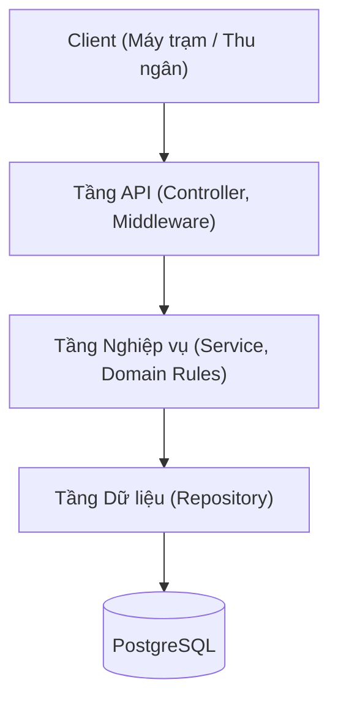
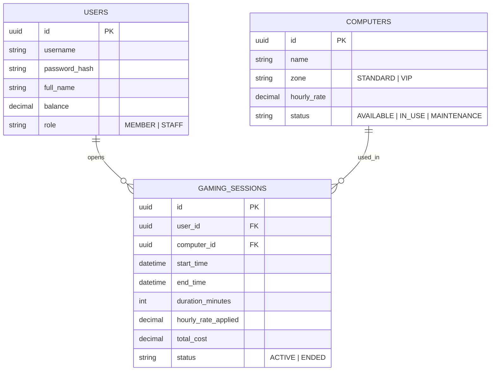

# Hệ thống quản lý quán net - Pha 1

## 1. Mô tả bài toán và nghiệp vụ cơ bản

### 1.1. Bài toán

Quản lý trạng thái máy trạm và tự động hóa tính tiền giờ chơi cho hội viên quán net theo thời gian thực. Hệ thống tính tiền theo số phút thực tế và mỗi máy chỉ nhận một phiên chơi.

| Role   | Nhiệm vụ                                                                                                                             |
| ------ | ------------------------------------------------------------------------------------------------------------------------------------ |
| Member | Đăng nhập/đăng xuất, xem danh sách máy, mở máy để chơi, theo dõi thời gian và số dư trong phiên, tắt máy tính tiền, xem lịch sử chơi |
| Staff  | Quản lý nạp tiền cho hội viên                                                                                                        |

Nghiệp vụ cơ bản:

- Hội viên chọn máy trống và gửi yêu cầu mở máy. Hệ thống kiểm tra số dư nếu đủ tiền cho tối thiểu 30 phút thì mở máy cho người chơi.
- Client tra cứu số phút đã chơi, tạm tính và số dư còn lại của phiên đang hoạt động.
- Kết thúc phiên chơi, hệ thống tính tiền theo số phút thực tế, trừ số dư tài khoản và giải phóng máy.

## 2. Kiến trúc hệ thống

### 2.1. Kiến trúc phân tầng

Hệ thống dùng mô hình 3 tầng:

### 2.2. Mô hình dữ liệu (ERD)

---

## 3. Đặc tả các API

- **Base URL:** `/api/v1`
- **Format dữ liệu:** `application/json`
- **Xác thực:** Gửi kèm header `Authorization: Bearer <access_token>` đối với các route yêu cầu đăng nhập.

### Bảng tổng hợp endpoint

| Nhóm           | Phương thức | Đường dẫn            | Quyền hạn | Mô tả                                    |
| -------------- | ----------- | -------------------- | --------- | ---------------------------------------- |
| **Xác thực**   | `POST`      | `/auth/login`        | Public    | Đăng nhập tài khoản lấy Access Token     |
|                | `POST`      | `/auth/logout`       | **Auth**  | Đăng xuất, vô hiệu hóa phiên làm việc    |
| **Hội viên**   | `GET`       | `/users/me`          | **Auth**  | Xem thông tin cá nhân và số dư hiện tại  |
|                | `POST`      | `/users/{id}/top-up` | **STAFF** | Thu ngân nạp tiền vào tài khoản hội viên |
| **Máy trạm**   | `GET`       | `/computers`         | Public    | Xem danh sách và trạng thái phòng máy    |
|                | `GET`       | `/computers/{id}`    | Public    | Xem chi tiết cấu hình và giá của một máy |
| **Phiên chơi** | `POST`      | `/sessions`          | **Auth**  | Mở máy / Bắt đầu phiên chơi              |
|                | `GET`       | `/sessions/me`       | **Auth**  | Xem thông tin phiên đang chơi hiện tại   |
|                | `DELETE`    | `/sessions/{id}`     | **Auth**  | Tắt máy / Kết thúc phiên chơi tính tiền  |
|                | `GET`       | `/sessions/history`  | **Auth**  | Xem lịch sử các phiên chơi trước đây     |

> Tài liệu API đầy đủ (OpenAPI 3.0) được FastAPI sinh tự động từ code. Khi server đang chạy: Swagger UI tại `/docs`, JSON schema tại `/openapi.json`.
